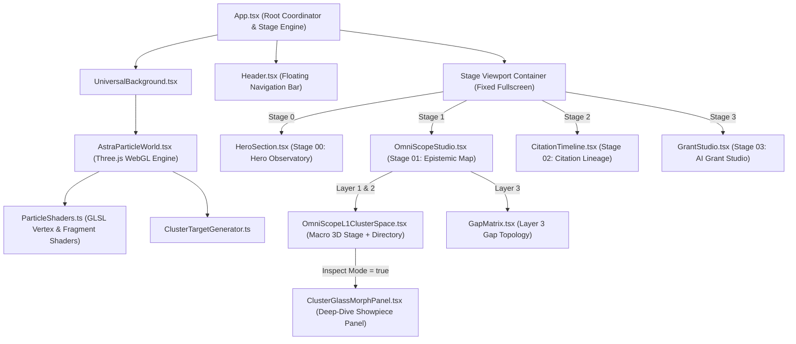

# ResearchRadar — Project Architecture & System Blueprint

## Executive Overview
**ResearchRadar** is an autonomous scientometric observatory and AI-powered research intelligence engine. It transforms academic paper corpora (from Semantic Scholar, arXiv, and OpenAlex) into interactive 3D knowledge manifolds, temporal citation lineages, topological research gap matrices, and grounded grant proposal hypotheses.

The application is built as a high-performance, single-page reactive application powered by **React 18 + TypeScript + Vite + Tailwind CSS + Three.js (WebGL GLSL Shaders)** on the frontend, and a **FastAPI + NumPy + SciPy + UMAP + HDBSCAN + NetworkX + Groq LLM** backend pipeline.

---

## 1. Complete Folder Tree

```
ResearchRadar/
├── .agents/                                # AI agent configs, prompts & specialized skills
│   └── skills/                             # 3D force graph, design systems, UI/UX skills
├── data/                                   # Ingestion corpora, caching layers & output datasets
│   ├── cache/                              # S2 query cache, OpenAlex entity verifier cache
│   ├── output_ad/                          # 3D points, citation graph, UMAP artifacts
│   ├── output_fl/                          # Federated Learning test corpus artifacts
│   └── output_<slug>/                      # Dynamic query-generated dataset outputs
├── frontend/                               # React 18 + Vite + Three.js Client
│   ├── public/                             # Static assets, SVG icons, favicons
│   ├── src/
│   │   ├── assets/                         # Static images and vector graphics
│   │   ├── components/                     # React UI Views & Glass Instruments
│   │   │   ├── ArchipelagoCanvas.tsx       # 2D Canvas Archipelago fallback/overlay
│   │   │   ├── CitationTimeline.css        # Timeline styling and animations
│   │   │   ├── CitationTimeline.tsx        # Stage 02: SPLC Citation Lineage & Milestones
│   │   │   ├── ClusterGlassMorphPanel.tsx  # Stage 01: Deep-Dive Cluster Inspection Glass Panel
│   │   │   ├── GapMatrix.tsx               # Stage 01 (Layer 3): Topological Gap Matrix
│   │   │   ├── GrantStudio.tsx             # Stage 03: AI Grant Studio & Hypothesis Generator
│   │   │   ├── Header.tsx                  # Master Floating HUD & Stage Navigation
│   │   │   ├── HeroSection.css             # Hero observatory visual styling
│   │   │   ├── HeroSection.tsx             # Stage 00: Search Deck & Live SSE Reasoning Tracker
│   │   │   ├── OmniScopeL1ClusterSpace.tsx # Stage 01: Macro 3D Stage & Thematic Directory Glass Panel
│   │   │   ├── OmniScopeStudio.tsx         # Stage 01: Container orchestrating L1/L3 views
│   │   │   ├── UniversalBackground.tsx     # Persistent WebGL Background Wrapper
│   │   │   └── fallback_stage5_data.json   # Static fallback citation graph
│   │   ├── data/
│   │   │   ├── realClusterData.ts          # Authentic fallback data (300 points, 10 clusters, filaments)
│   │   │   └── realNarratedGaps.ts         # Authentic fallback narrated gap proposals
│   │   ├── particles/                      # Three.js WebGL Particle Engine
│   │   │   ├── AstraParticleWorld.tsx      # Unified 3D WebGL Canvas, Camera Rig & Render Loop
│   │   │   ├── ClusterTargetGenerator.ts   # BufferAttribute generator & coordinate scaler
│   │   │   ├── ParticleShaders.ts          # GLSL Simplex/Curl Noise & Quintic Morph Shaders
│   │   │   └── ParticleTypes.ts            # Particle data structures and metadata interfaces
│   │   ├── App.css                         # Global CSS overrides & custom scrollbars
│   │   ├── App.tsx                         # Root Stage Orchestrator & Transition Engine
│   │   ├── index.css                       # Tailwind CSS directives & design tokens
│   │   ├── main.tsx                        # React DOM mounting entrypoint
│   │   └── types.ts                        # Shared TypeScript Data Contracts
│   ├── index.html                          # HTML shell & font definitions
│   ├── package.json                        # Frontend NPM dependencies
│   ├── tailwind.config.js                  # Design tokens, obsidian palettes & typography
│   └── vite.config.ts                      # Vite build configuration & API proxy
├── research_radar/                         # Backend Python Scientometric Engine
│   ├── entities/                           # Entity normalization & OpenAlex taxonomy
│   │   ├── openalex_normalizer.py          # Concept hierarchy extractor
│   │   ├── schema.py                       # Entity schemas
│   │   └── universal_extractor.py          # Cross-domain entity extractor
│   ├── scripts/                            # Pipeline maintenance & citation enrichment
│   ├── api.py                              # FastAPI REST & SSE Streaming Controller
│   ├── domain_compatibility.py             # Cross-cluster affinity & compatibility scoring
│   ├── export_3d.py                        # UMAP 3D to WebGL JSON transformation pipeline
│   ├── literature_verifier.py              # Real-time citation verification
│   ├── operational_hypothesis.py           # Hypothesis generator for research gaps
│   ├── pipeline.py                         # Master 8-Stage Pipeline CLI Orchestrator
│   ├── rate_state.py                       # Token bucket rate limiter for S2 API
│   ├── s2_client.py                        # Semantic Scholar REST API Client
│   ├── specificity_engine.py               # Topic specificity & MDL clustering
│   ├── stage1_ingest.py                    # Stage 1: API paper ingestion & caching
│   ├── stage2_preprocess.py                # Stage 2: Abstract tokenization & cleaning
│   ├── stage3_embed.py                     # Stage 3: SciBERT / SPECTER2 neural embeddings
│   ├── stage4_topics.py                    # Stage 4: HDBSCAN / BERTopic cluster extraction
│   ├── stage5_citations.py                 # Stage 5: Epistemic Citation Journey (02 Citations)
│   ├── stage6_domain_clusters_archipelago.py # Stage 6: Epistemic Archipelago & 3D Manifold (01 Domain Clusters)
│   ├── stage7_gap_detection.py             # Stage 7: Bipartite structural hole gap detection
│   └── stage8_llm_narration.py             # Stage 8: Groq/Llama-3 RAG gap narration
├── tests/                                  # Rigor and validation test suites
├── Dockerfile                              # Multi-stage production container build
├── docker-compose.yml                      # Containerized deployment spec
└── requirements.txt                        # Python dependencies
```

---

## 2. Relevant File Directory & Roles

### Frontend Presentation & UI Layer
| File | Path | Role & Purpose |
| :--- | :--- | :--- |
| **`App.tsx`** | `frontend/src/App.tsx` | Master view coordinator. Manages discrete stage indexing (0: Hero, 1: Epistemic, 2: Timeline, 3: Grant), scroll/wheel/touch/key event interception, timed transition staging, and global API dataset state. |
| **`Header.tsx`** | `frontend/src/components/Header.tsx` | Sticky floating HUD bar with glassmorphic backdrop. Provides stage tab switching, return-to-hero triggers, dataset selector, and active tab status. |
| **`HeroSection.tsx`** | `frontend/src/components/HeroSection.tsx` | Stage 00 landing observatory. Search bar for querying Semantic Scholar, corpus size selection (300 to 3k), preset topic buttons, and live 8-stage SSE reasoning progress tracker. |
| **`OmniScopeStudio.tsx`** | `frontend/src/components/OmniScopeStudio.tsx` | Stage 01 container. Selects between Level 1 (3D Cluster Space) and Level 3 (Gap Matrix) without unmounting the underlying 3D particle world. |
| **`OmniScopeL1ClusterSpace.tsx`** | `frontend/src/components/OmniScopeL1ClusterSpace.tsx` | Stage 01 macro view. Divides viewport into left 54% interactive 3D WebGL stage and right 46% glassmorphic thematic research directory. Dispatches camera commands and triggers deep-dive inspect mode. |
| **`ClusterGlassMorphPanel.tsx`** | `frontend/src/components/ClusterGlassMorphPanel.tsx` | Stage 01 deep-dive inspect panel. Renders glassmorphic card with landmark anchor paper, data-driven timeline/citation/growth insights, publication search, and paper list. |
| **`CitationTimeline.tsx`** | `frontend/src/components/CitationTimeline.tsx` | Stage 02 view. Renders Search Path Link Count (SPLC) citation lineage, milestone papers, temporal epochs, and citation connectivity. |
| **`GapMatrix.tsx`** | `frontend/src/components/GapMatrix.tsx` | Stage 01 Layer 3 view. Renders algorithmic structural holes, method vs application matrices, novelty bridge scores, and routes gaps to Grant Studio. |
| **`GrantStudio.tsx`** | `frontend/src/components/GrantStudio.tsx` | Stage 03 view. Renders structured operational hypotheses, experimental methodologies, risk matrices, and exportable grant proposals. |
| **`UniversalBackground.tsx`** | `frontend/src/components/UniversalBackground.tsx` | Wrapper mounting `AstraParticleWorld` as a single shared background across all stages. |

### WebGL 3D Particle & Shader Engine
| File | Path | Role & Purpose |
| :--- | :--- | :--- |
| **`AstraParticleWorld.tsx`** | `frontend/src/particles/AstraParticleWorld.tsx` | Single persistent Three.js WebGL canvas. Runs continuous requestAnimationFrame loop, orthographic background shader, 3D coordinate frame, Torus Knot, 3D camera spline flight, and raycasting. |
| **`ParticleShaders.ts`** | `frontend/src/particles/ParticleShaders.ts` | Custom GLSL vertex & fragment shaders. Computes GPU simplex/curl noise drift, quintic S-curve progress morphing, dynamic point sizing, and crisp luminous border disc rendering. |
| **`ClusterTargetGenerator.ts`** | `frontend/src/particles/ClusterTargetGenerator.ts` | Transforms raw JSON 3D points and cluster metadata into typed Float32BufferAttributes (positions, home stardust, targets, colors, delays, sizes, cluster IDs, outliers). |
| **`realClusterData.ts`** | `frontend/src/data/realClusterData.ts` | Complete authentic fallback dataset (300 papers, 10 topic clusters, semantic filaments, citations, abstracts) ensuring zero-blank-screen resilience. |
| **`types.ts`** | `frontend/src/types.ts` | Canonical TypeScript interfaces: `Points3DData`, `Cluster3DPoint`, `ArchipelagoData`, `CitationData`, `ResearchGap`, `NarratedGap`, `PipelineProgressEvent`. |

### Backend Service & Scientometric Pipeline
| File | Path | Role & Purpose |
| :--- | :--- | :--- |
| **`api.py`** | `research_radar/api.py` | FastAPI application. Serves REST endpoints for datasets, 3D points, citation DAGs, gaps, and SSE streaming pipeline execution (`/api/pipeline/run`). |
| **`pipeline.py`** | `research_radar/pipeline.py` | Core CLI and backend pipeline runner executing Stages 1 through 8 sequentially. |
| **`stage1_ingest.py`** | `research_radar/stage1_ingest.py` | Fetches academic papers with abstracts, citation counts, and publication years via Semantic Scholar API with rate limiting. |
| **`stage3_embed.py`** | `research_radar/stage3_embed.py` | Generates 768-dimensional dense vector embeddings using SciBERT/SPECTER2 models. |
| **`stage4_topics.py`** | `research_radar/stage4_topics.py` | Clusters embeddings via HDBSCAN and generates descriptive topic labels with c-TF-IDF / BERTopic. |
| **`stage5_citations.py`** | `research_radar/stage5_citations.py` | Computes chronological milestones, bibliographic overlap, and authority scores (Powers website **02 Citations** tab). |
| **`stage6_domain_clusters_archipelago.py`** | `research_radar/stage6_domain_clusters_archipelago.py` | Projects high-dimensional embeddings to 3D UMAP manifold and macro filaments (Powers website **01 Domain Clusters** tab). |
| **`stage7_gap_detection.py`** | `research_radar/stage7_gap_detection.py` | Identifies topological white spaces, method-application disconnects, and unbridged scientific clusters. |
| **`stage8_llm_narration.py`** | `research_radar/stage8_llm_narration.py` | Synthesizes grounded grant proposals and operational hypotheses via Groq LLM RAG engine. |
| **`export_3d.py`** | `research_radar/export_3d.py` | Formats pipeline outputs into `cluster_3d_points.json` consumed directly by frontend WebGL buffers. |

---

## 3. Component Hierarchy & Relationships



---

## 4. Particle & Data Flow Architecture

```
[ Backend API / Cached JSON ]
           │
           ▼
[ fetch('/api/graph/points3d?dataset=...') ]
           │
           ▼ (Points3DData object)
[ App.tsx (setPoints3dData) ]
           │
           ▼ (Passed via props)
[ UniversalBackground -> AstraParticleWorld ]
           │
           ▼
[ ClusterTargetGenerator.convertPoints3DData() ]
           │  • Normalizes cluster IDs (0..K-1, -1 for outliers)
           │  • Normalizes UMAP coordinates to centered world bounds [-2.5, 2.5]
           │  • Extracts centroid positions, citation radiuses, cluster metadata
           │
           ▼
[ ClusterTargetGenerator.generateAstraParticleData() ]
           │  • Generates homePositions (curled atmospheric stardust sphere)
           │  • Generates targetPositions (real 3D UMAP manifold cluster points)
           │  • Assigns hex colors: aColorHome (warm/cool cosmic) -> aColorTarget (cluster palette)
           │  • Computes per-particle delay offsets [0.0 .. 0.14] for staggered wave flight
           │  • Packs buffers into Float32Array attributes
           │
           ▼
[ THREE.BufferGeometry (ptsGeo) ]
           │  • position, aTargetPosition, aColorHome, aColorTarget
           │  • aDelay, aRandom, aSize, aClusterId, aIsOutlier
           │
           ▼
[ GPU Vertex Shader (ParticleShaders.ts) ]
           │  • uTime, uProgress (0.0 -> 1.0), uConstellationMatrix, uConstellationX
           │  • Simplex Curl Noise: Ambient rest drift on Hero
           │  • Quintic S-Curve Easing: Morphing from homePos to rotatedTarget
           │  • Left 54% Viewport Shift: target.x += -0.95 * p
           │  • Turntable Rotation Matrix: applied to target constellation
           │  • Focus Showpiece Mode: Scaled 2.5x local cluster inspection
           │
           ▼
[ GPU Fragment Shader (ParticleShaders.ts) ]
           │  • Luminous white rim disc rendering (anti-aliased circular points)
           │  • Outlier grey toning vs. vibrant saturated cluster highlights
           │  • Rendered to shared canvas
```

---

## 5. Camera Architecture

The camera system uses a single persistent `THREE.PerspectiveCamera` (FOV: 46°, near: 0.1, far: 100) managed inside `AstraParticleWorld.tsx`.

### Camera Spline & Stage Interpolation
The camera position (`camera.position`) and look-at target (`camera.lookAt`) smoothly glide along a deterministic 3D spline as `activeTab` changes:

| Stage / View | Target Position `(X, Y, Z)` | Target LookAt `(X, Y, Z)` | Purpose |
| :--- | :--- | :--- | :--- |
| **`00 Hero`** | `(0.0, 0.0, 7.2)` | `(0.0, 0.0, 0.0)` | Wide cosmic overview framing the ambient stardust and Torus Knot. |
| **`01 Epistemic`** | `(0.10, 0.08, 5.6)` | `(-0.35, 0.0, 0.0)` | Zooms in, pans right so the 3D constellation frames the left 54% viewport. |
| **`02 Timeline`** | `(0.0, 0.0, 6.5)` | `(0.0, 0.0, 0.0)` | Re-centered, medium-depth camera allowing particle constellation to fade gracefully. |
| **`03 Grant`** | `(0.0, 0.0, 6.9)` | `(0.0, 0.0, 0.0)` | Pulled back, centered atmospheric view with zero HUD occlusions. |

### Interactive Camera Controls (Custom Events `rr-camera-cmd`)
- **Continuous 360° Turntable**: Automatic rotation around Y-axis (`orbitAngleYRef.current += dt * 0.22`) when idle.
- **Mouse Drag Orbit**: Dragging in 3D viewport updates `orbitAngleXRef` (clamped [-1.4, 1.4]) and `orbitAngleYRef`.
- **Zoom**: Wheel with `Ctrl`/`Meta` or standard pinch modifies `targetCameraZ` [2.2 .. 12.0].
- **Reset Overview**: Event `{ cmd: 'reset_overview' }` resets camera to `(0.0, 0.0, 6.2)` and clears focus mode.
- **Top View (2D)**: Event `{ cmd: 'top' }` snaps camera to `orbitAngleX = 1.52`, `orbitAngleY = 0` (top-down orthogonal projection).
- **Side View (3D)**: Event `{ cmd: 'side' }` snaps camera to `orbitAngleX = 0.05`, `orbitAngleY = 1.57`.
- **Showpiece Focus**: Event `{ cmd: 'focus_showpiece', clusterId }` targets cluster centroid, zooms in (`targetCameraZ = 3.6`), and spins selected cluster in isolation.

---

## 6. Glass-Panel Architecture

The UI utilizes a **Zero-Collision Floating Glassmorphism** design system. The 3D WebGL canvas occupies the full viewport behind the DOM, while UI controls float in semi-transparent glass containers.

### Design Tokens & CSS Properties
- **Backdrop Blur**: `backdrop-blur-2xl` (32px blur radius) + `backdrop-saturate-150`.
- **Surface Fill**: `bg-[#0b101d]/65` (deep obsidian with 65% opacity).
- **Border**: `border border-white/[0.12]` (crisp 1px white border with 12% opacity).
- **Glass Specular Rim**: `shadow-[0_25px_60px_rgba(0,0,0,0.7),inset_0_1px_0_rgba(255,255,255,0.15)]`.
- **Refraction Glow**: Dynamic radial gradient blur positioned top-right colored to match the active cluster's theme:
  ```tsx
  <div
    className="absolute -top-16 -right-16 w-56 h-56 rounded-full blur-3xl opacity-20"
    style={{ backgroundColor: activeCluster?.color || '#38bdf8' }}
  />
  ```

### Spatial Partitioning
- **Left Stage (54%)**: Fully transparent `pointer-events-none` container allowing direct pointer interaction (drag, hover, raycasting, double-click) with the Three.js canvas. Floating HUD chips (360° auto-rotate toggle, view angles) have `pointer-events-auto`.
- **Right Stage (46%, max-width 580px)**: Contains either `ClusterGlassMorphPanel` (in inspect mode) or the Thematic Research Directory list (in overview mode). Internal lists use `.overflow-y-auto` and `.custom-scrollbar`.

---

## 7. Transition Architecture (Home → Epistemic)

The transition from **00 Hero Observatory** to **01 Epistemic Map** is a **2.4-second timed, GPU-accelerated physical choreography** orchestrated without page reloads or canvas destruction.

```
Time (t)      Action / Visual Event
──────────────────────────────────────────────────────────────────────────────────────────
t = 0 ms      User triggers transition (scroll wheel down, search launch, or tab click).
              • App.tsx sets stageStates: ['exiting', 'hidden', 'hidden', 'hidden'].
              • HeroSection starts fading out (opacity -> 0, transition: 400ms).
              • astraState.viewMode switches to 'studio', activeTab switches to 'archipelago'.
              • WebGL transitionClock begins advancing (0.0 -> 2.4s).

t = 400 ms    Hero DOM element unmounts/hides (display: none).
              • Pure 3D WebGL Canvas is now the sole hero element in the entire viewport.
              • Signature Torus Knot begins shrinking and dissolving (opacity -> 0).
              • Atmospheric stardust particles begin their coherent physical flight.

t = 400–1400ms High-speed GPU particle flight:
              • Quintic S-curve progress evaluates from 0.0 -> 0.85.
              • Particles accelerate along curved aerodynamic streamlines.
              • Particle colors morph from galaxy amber/teal to distinct cluster hex codes.
              • Constellation center shifts smoothly left by -0.95 units to frame left 54%.
              • Camera glides forward along Z-axis (7.2 -> 5.6).

t = 1400 ms   Particles settle into their authentic 3D UMAP cluster positions.
              • App.tsx sets stageStates: ['hidden', 'entering', 'hidden', 'hidden'].
              • OmniScopeStudio mounts in entering state (opacity 0 -> 1, 450ms bezier).
              • 3D Coordinate Bounding Box and Axis Text Sprites fade in (gridAlpha -> 1.0).

t = 2400 ms   Transition complete.
              • App.tsx sets stageStates: ['hidden', 'active', 'hidden', 'hidden'].
              • OmniScopeStudio reaches full interactivity (pointerEvents: 'auto').
              • Continuous 360° turntable orbit engages.
              • isAnimatingRef locks released.
```

---

## 8. State Management Architecture

State is cleanly partitioned into **Discrete View State**, **WebGL Module State**, and **Data Cache State**:

```
                              ┌─────────────────────────────┐
                              │          App.tsx            │
                              │  • stageIndex (0..3)        │
                              │  • stageStates (active/...) │
                              │  • selectedDataset          │
                              │  • points3dData             │
                              │  • citationData             │
                              │  • detectedGaps             │
                              │  • narratedGaps             │
                              │  • selectedClusterId        │
                              └──────────────┬──────────────┘
                                             │
                      ┌──────────────────────┼──────────────────────┐
                      ▼                                             ▼
       ┌──────────────────────────────┐              ┌──────────────────────────────┐
       │   Module-Level astraState    │              │       DOM Event Bus          │
       │  (AstraParticleWorld.tsx)    │              │  (Custom Events)             │
       │  • viewMode ('hero'|'studio')│              │  • 'rr-camera-cmd'           │
       │  • activeTab ('archipelago') │              │  • 'rr-paper-hover'          │
       │  • selectedClusterId         │              │  • 'rr-paper-click'          │
       │  • scrollProgress            │              └──────────────────────────────┘
       └──────────────────────────────┘
```

### Event-Driven Communication
To maintain 60 FPS without triggering React re-render cascades in the 3D loop:
- **Camera Commands**: UI buttons dispatch `window.dispatchEvent(new CustomEvent('rr-camera-cmd', { detail: { cmd, clusterId } }))`. `AstraParticleWorld` listens and animates camera coordinates directly.
- **Paper Hover/Click Raycasting**: Three.js raycaster dispatches `window.dispatchEvent(new CustomEvent('rr-paper-hover', { detail: { paper, screenX, screenY } }))` for tooltips.
- **Scroll Hijacking Guard**: The `handleWheel` listener checks `e.target.closest('.overflow-y-auto')` and verifies whether the user is at the top/bottom boundary before executing a stage change.

---

## 9. Exact Files Responsible for Home → Epistemic Transition

| Order | File | Lines | Specific Responsibility in Transition |
| :---: | :--- | :--- | :--- |
| **1** | **`frontend/src/App.tsx`** | Lines 71–112 | `goToStage(1)`: Coordinates the 2.4s multi-phase timer sequence, sets `stageStates` from `exiting` to `entering` to `active`, and passes `activeTab='archipelago'` to `UniversalBackground`. |
| **2** | **`frontend/src/App.tsx`** | Lines 179–218 | `handleWheel`: Detects directional delta scroll threshold (220px) with velocity decay and triggers stage advancement. |
| **3** | **`frontend/src/components/HeroSection.tsx`** | Lines 400–430 | Dispatches search submission or preset clicks (`onLaunch` / `onSearch`) to trigger `goToStage(1)`. |
| **4** | **`frontend/src/components/UniversalBackground.tsx`** | Lines 1–40 | Passes `viewMode`, `activeTab`, and `points3dData` seamlessly to the particle world. |
| **5** | **`frontend/src/particles/AstraParticleWorld.tsx`** | Lines 680–704 | Advances `transitionClock` (0.0 -> 2.4s) using delta-time and calculates quintic progress `progress = tNorm^3 * (tNorm * (6tNorm - 15) + 10)`. |
| **6** | **`frontend/src/particles/AstraParticleWorld.tsx`** | Lines 770–798 | Shifts constellation `uConstellationX = -0.95 * progress`, dissolves Torus Knot `knotFade = 1.0 - progress * 2.6`, and fades in 3D coordinate grids. |
| **7** | **`frontend/src/particles/AstraParticleWorld.tsx`** | Lines 800–848 | Camera spline interpolation: Lerps camera position `Z: 7.2 -> 5.6` and look-at `X: 0.0 -> -0.35` to frame left 54%. |
| **8** | **`frontend/src/particles/ParticleShaders.ts`** | Lines 131–159 | Vertex Shader: Morphs each particle from `homePos` to `rotatedTarget` with coherent swirl `sin(p * π) * 0.24` and settling damping. |
| **9** | **`frontend/src/particles/ParticleShaders.ts`** | Lines 209–221 | Fragment Shader: Morphs particle colors from cosmic amber/teal to authentic cluster palette via `smoothstep(0.05, 0.75, p)`. |
| **10** | **`frontend/src/components/OmniScopeStudio.tsx`** | Lines 35–52 | Mounts `OmniScopeL1ClusterSpace` with zero visual flash. |
| **11** | **`frontend/src/components/OmniScopeL1ClusterSpace.tsx`** | Lines 196–340 | Renders right-hand Thematic Research Directory glass panel with smooth slide/fade entrance. |

---

## 10. Summary of Top 20 Most Critical Source Files

1. **`frontend/src/App.tsx`** — Root stage coordinator and transition scheduler.
2. **`frontend/src/particles/AstraParticleWorld.tsx`** — Persistent Three.js WebGL canvas and render loop.
3. **`frontend/src/particles/ParticleShaders.ts`** — GLSL simplex/curl noise and quintic morph shaders.
4. **`frontend/src/particles/ClusterTargetGenerator.ts`** — BufferAttribute generator and UMAP coordinate mapper.
5. **`frontend/src/components/HeroSection.tsx`** — Stage 00 search observatory & live SSE reasoning tracker.
6. **`frontend/src/components/OmniScopeStudio.tsx`** — Stage 01 container component.
7. **`frontend/src/components/OmniScopeL1ClusterSpace.tsx`** — Stage 01 macro 3D stage and glass directory panel.
8. **`frontend/src/components/ClusterGlassMorphPanel.tsx`** — Stage 01 deep-dive inspect panel.
9. **`frontend/src/components/UniversalBackground.tsx`** — WebGL background wrapper.
10. **`frontend/src/components/CitationTimeline.tsx`** — Stage 02 SPLC citation lineage view.
11. **`frontend/src/components/GapMatrix.tsx`** — Stage 01 Layer 3 topological gap matrix.
12. **`frontend/src/components/GrantStudio.tsx`** — Stage 03 AI grant proposal studio.
13. **`frontend/src/components/Header.tsx`** — Sticky HUD navigation bar.
14. **`frontend/src/data/realClusterData.ts`** — Authentic fallback dataset (300 points, 10 clusters).
15. **`frontend/src/types.ts`** — Shared TypeScript data contracts.
16. **`research_radar/api.py`** — FastAPI backend REST and SSE streaming endpoints.
17. **`research_radar/pipeline.py`** — Master 8-stage scientometric pipeline orchestrator.
18. **`research_radar/stage6_domain_clusters_archipelago.py`** — 3D UMAP manifold and domain archipelago generator.
19. **`research_radar/stage7_gap_detection.py`** — Algorithmic gap detection engine.
20. **`research_radar/export_3d.py`** — 3D JSON exporter for WebGL buffer consumption.
